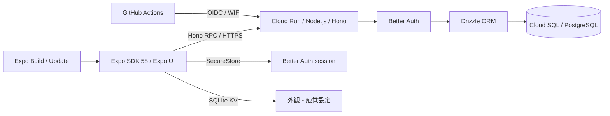

# アーキテクチャと技術選定

基準は2026年11月5日の[Expo技術選定検討](chatgpt-conversation://6aec01ec-6938-83e8-94df-24f41ae3ad55)と提供された開発仕様。依存関係の実際の解決版は `bun.lock` を正本とする。

## 採用構成

- Node.js 24、Bun 1.4.4、Expo 58、React Native 0.88、React 19.3。ネイティブ依存は `expo install` で互換版を選ぶ。
- Bun Workspaces + Turborepo。モバイルのネイティブモジュールを一つに解決するため、Bunの **hoisted linker** を明示する。
- Expo Routerは画面ルーティング専用。Honoを別サーバーとしてCloud Runで動かす。
- `@starter/api/contract` は `AppType` のtype-only公開入口。モバイルはHono RPCの型を再利用し、API実装をbundleへ混入させない。
- Zodは入力検証と共有モデル、DrizzleはPostgreSQLスキーマとmigrationを所有する。Drizzle ORM / Kitは `1.0.0-rc.5` に固定する。
- Better Auth 1.7.17 + Expo pluginでGoogle／Apple OAuth・email magic link・passkey。セッションはSecureStore。ローカルはVercel Emulateを使い、Google Cloudや実プロバイダのキーなしで認証する。

Drizzle 1.0 RCは[公式の移行手順](https://orm.drizzle.team/docs/upgrade-v1)に従って採用する。DB接続は `drizzle({ client: pool })` を使い、認証のschemaはBetter Authのadapterへ渡す。Kitで廃止された `strict` 設定は削除した。既存migrationは `drizzle-kit up` でSQLとsnapshotを同じディレクトリへ移し、snapshotをversion 9へ変換した。SQLの内容・ハッシュと適用順序は保持し、テーブルの作り直しは行わない。

## 環境変数

API・mobile・Emulateは各 `apps/*/src/env.ts` で[envalid](https://github.com/af/envalid)を使って環境変数を検証する。`process.env` の参照・書き込みはこの入口に限定し、アプリごとの型はvalidatorから推論する。HTTP入力と共有モデルは引き続きZodが担当する。

APIはsecretの32文字以上、productionのHTTPS、ローカルEmulate接続先の制限を維持する。migrationと認証統合テストのDB準備は `readDatabaseEnv()` でDATABASE_URLだけを要求する。エラーは項目名だけを含め、値をログへ出さず例外として停止する。Emulateはproductionでは起動しない。

mobileは公開API URLとpasskey RP IDだけを検証する。Expoの静的置換のため、`process.env.EXPO_PUBLIC_*` を `src/env.ts` 内で直接参照する。API URLの空値は未設定として扱い、末尾のスラッシュを除去する。app configは同じ入口の `loadBuildEnv()` でComposeの開発originを補ってからMetroへ渡す。公開URL・RP IDは未設定でも起動でき、API接続とネイティブpasskeyだけが無効になる。secretやサーバー用envをmobileへ渡さない。

## UIと端末内データ

日本語SNSへ用途を変更した。ホーム、マイページ、設定をNative Tabs／Stackで構成する。X型のFlatList、投稿、反応はReusables Text／Button + Uniwind Free 1.13.2／Tailwind CSS 4.3.4、設定とOS操作は共通 `@expo/ui`。SF SymbolsとMaterialの両ソースを指定する。

独自UIはCSSのneutralテーマ、標準UIはOSセマンティックカラー。端末内の外観設定から `Uniwind.setTheme` へ一本化して連動する。Portal・Reanimated等は追加しない。[UI開発手順](ui.md)を参照。

AndroidのMaterial色は参照時に解決されるため、`useColors` で外観変更を購読し、schemeに応じて再取得する。SDKのネイティブgetterをReact Compilerが固定化することを避けるため、この境界だけをコンパイル対象から外し、明示的な `useMemo` を使う。投稿行のmemo化やTanStack Queryの更新範囲、iOSのセマンティックカラーは維持する。

外観と触覚は `expo-sqlite/kv-store`。投稿といいねはPostgreSQLに保存し、ログインユーザーに紐付く。以前の習慣・お気に入り・完了・目標はSNSサンプルから除いた。API未設定時は接続案内を表示する。

投稿一覧は空・初回読み込み・失敗でも同じFlatListと取得済みのプロフィール概要を使う。空・失敗の説明は中央に配置し、初回読み込みは投稿カードの枠を共有した静止スケルトンで表す。再取得では既存の投稿を残し、手動のpull-to-refreshとは区別する。端末検証では専用worktreeのAPIを使って状態を作り、アプリに検証用の遅延や状態切替を組み込まない。

## APIと認証の境界

`tablecast-poc/apps/api` のcomposition rootとモジュール公開入口を参考に、`app.ts`、`env.ts`、`db`、`modules/auth`、`modules/social` へ分離した。organization／店舗・Cloudflare固有処理は持ち込まない。公開RPCは `contract.ts` の型だけ。

Better Authが認証し、Honoの `requireSession` と所有者条件が投稿・削除・いいねを認可する。入力はZod、いいねは複合主キーで冪等。公開フィードは著者ID・表示名・画像だけを返し、メールを公開しない。マジックリンクは10分・単回利用・ハッシュ保存、WebAuthnは署名／challenge／originを検証する。共通rate limitはDB保存。

プロフィール更新は認証済みの本人だけが行える。端末が写真を選択・縮小し、APIが最大256 KiBのJPEGを検証して512px正方形に再エンコードする。メタデータを落とした画像1枚をPostgreSQLの `avatar` テーブルに保存し、表示名と画像URLを同じトランザクションで更新する。ローカルでも追加のストレージ設定は要らない。フィードとプロフィールには画像URLだけを返す。既存のOAuth・seed画像URLは、利用者が写真を変更または削除するまで使い続ける。保存後はセッションと該当ユーザーのキャッシュを更新し、他の投稿を再取得しない。

認証CookieはDomain属性を指定せず、発行元のAPIホストに限定する。MetroやEmulateとの親ドメイン共有は不要。ネイティブはBetter Auth ExpoのSecureStoreとCookie送信を使う。PasskeyのRP IDはCookie共有とは別の設定である。

Google／AppleのEmulate issuer・JWKS・token endpointを使うgenericOAuthを開発時だけ登録する。実署名のID tokenを検証し、認証バイパスは設けない。本番でのEmulate起動と公開エミュレータURLを拒否する。メールはResend互換エミュレータへ送る。[設定と検証](auth.md)を参照。

`eslint-plugin-boundaries` がAPI composition root→module、social→authの公開入口、module→DB/platform/shared、モバイルroutes→UI→lib、型のみのAPI契約を強制する。禁止方向・内部ファイルの直接import・未知ファイルはエラー。`scripts/boundaries.test.ts` で許可・禁止例を実際のESLintへ通す。

## worktreeと開発プロセス

正式名称、URLスキーム、保存prefixは `expo-hono-opentofu-starter`。両OSのアプリIDは `dev.reohakase.expohonopentofustarter`。旧識別子との互換処理・端末データの移行は設けず、新しいビルドと保存領域を使う。Expo owner、slug、project ID、Updates URLは既存接続を維持し、fingerprintでネイティブ互換性を管理する。

作業用worktreeは `expo-hono-opentofu-starter-<issue>-<topic>` と命名し、ブランチ `codex/<issue>-<topic>` と同じtopicを使う。ディレクトリ末尾名をホスト内で一意なDNSラベルに揃え、Compose標準のproject名として使う。独自の実パスハッシュと明示的なCompose nameは廃止した。同じ末尾名は親ディレクトリが異なってもprojectを共用するため、並列開発では名前を重複させない。branch変更やdetached HEADでproject名は変わらないが、ディレクトリ名を変えるとDB・volumeも別になる。

POSIXの初期化処理はcheckoutとGit共通ディレクトリの実パスだけをルートのGit管理外 `.env` へ生成する。symlinkは実パスへ正規化する。アプリenvとsecretは各checkoutに置く。旧ハッシュ名の環境からは新しい標準名のDBで開始し、旧volumeの自動移行・削除は行わない。

ローカル実行はDocker Composeに統一し、ホストのPortless 0.16.0の[Compose連携](https://portless.sh/commands#docker-compose)でAPI・Metroの公開ポートとrouteを管理する。共有HTTPS/443 proxyを使い、ホスト名は `<service>.<Compose project名>.localhost`。コンテナ内の8080/8081は固定し、Portlessがloopback上の空きポートへ書き換える。DB等の非HTTPポートはPortlessの書換対象外なので、PostgreSQLはCompose内部の5432だけで待ち受ける。通常のMetroは `EXPO_PACKAGER_PROXY_URL` でbundleの公開URLもPortlessへ向け、Expo Go構成では空に戻してトンネルを優先する。

Composeの `setup` が依存導入・未作成env生成、`migrate` がDB healthcheck後のmigrationを担当する。APIはmigration完了後、Metroはsetup完了後に起動する。独自の子プロセス監視・ポート解決・ホストとコンテナの二重実行経路は廃止した。CI/Cloud Runは生のpackageコマンドで明示DATABASE_URLを使う。Turborepoは検査・テストの依存順とキャッシュを担当する。

Compose project名でDB、ネットワーク、依存関係・認証設定のvolumeを分離する。Bunのdownload cacheはrootの `node_modules` volume内に置き、Linuxのhardlinkでインストール先との重複保存を避ける。checkoutとGit共通ディレクトリは同じ絶対パスへmountする。Dev Containerの `workspace` は編集用であり、API・Metroを起動・再作成しない。API・Metroの `up` / `down` は必ずホストのPortlessを通し、同一projectへの再度の `up` はCompose標準どおり再利用・更新する。

Expoの接続モードとQRは標準CLIを使う。実機ではMetroを `compose.go.yaml` のExpo Goトンネル構成で起動し、APIは別のHTTPSトンネルまたはCloud Runへ接続する。認証URLは明示のトンネルURLを優先し、空の場合だけ開発用Compose originを使う。本番にはこの補完を適用しない。

Simulator／Emulatorの日常開発はDevelopment BuildとホストのExpo Device Hub 0.21.0を使う。`dev:devices` はPortlessの名前付きHTTPS URLを読み、Git管理外の `.env.devices` とCompose overrideで端末とホストの公開originを統一する。当初のHTTPループバック案は、Better Auth Expoの認可proxyがHTTP認可URLを拒否したため採用しない。OAuthのissuerとcallbackはHTTPS、token交換・DB・メール送信は既存の内部経路とする。各仮想端末にPortlessの公開CAを登録し、Androidでは生成した名前を専用AVDのhostsに追加する。AndroidのCA信頼はdebug source setの `.localhost` に限定し、releaseには含めない。ADBは端末ごとに共有proxyだけを転送するため、他worktreeの利用中には解除しない。独自proxyや常駐DNS・監視処理は追加しない。

設定とSecureStoreはインストール済みアプリ単位であり、worktree別アプリIDは生成しない。端末で複数worktreeを切り替える場合、APIのログイン状態を確認する。各APIのDBとsecretは独立する。

GCPのリソースprefixは正式名称と環境名から決める。サービスアカウントとWIF poolだけは、22文字を超えるprefixを先頭13文字とSHA-256先頭8文字（ハイフン区切り）へ短縮する。既存stateの切替・リソース置換は自動実行しない。

## 品質ゲート

- Oxlint: Expo公式 `oxlint-config-universe/native` とNode設定、型付き解析。unsafe、未処理Promise、循環import、Hooks、テストの `.only` / skipを検査。
- ESLint: Perfectionist、正規表現、複雑度、Hono、Drizzle、Turborepo、Testing Libraryなど、Oxlint本体と重複させない補完ルールだけ。依存境界は `eslint-plugin-boundaries`、type-onlyの `no-restricted-imports`、packageの公開exportsで制限する。
- Oxfmt: 現在のCLIが正式対応する `.oxfmtrc.json` を使用。仕様案の `oxfmt.config.ts` に固執しない。
- Fallow: Expo Routerとworkspaceの公開入口を検出。ネイティブautolinkingやBabelが利用する依存、トンネル用CLIだけを明示的に除外する。
- Lefthook: stagedファイルの整形/lintとCommitlint。Conventional Commitsを要求し、Gitmoji・Issue番号は必須にしない。
- Bun Test: 共有ロジック、HTTP契約、実DB認証。Jest + jest-expo + RNTL: モバイルの画面操作。Maestro: 必要時だけ。

Jestのtransform設定にはBunのisolated配置も許可している。React Native 0.88のFlow/ESMを正しく変換するためで、テスト対象のアプリコードを除外しない。

## インフラと配信の所有者

2026年11月7日の[Expoアプリ共有方法比較](chatgpt-conversation://6aee4c98-58bc-83ee-939a-d32402ae2c83)に基づき、今後のネイティブ機能をWeb互換性で制約しないため、Expo Web対応は見送る（[Issue #18](https://github.com/ReoHakase/expo-hono-opentofu-starter/issues/18)）。共有用の `preview` はAndroid APKとiOS Simulator用アプリに統一する。開発クライアントを無効にし、Metroなしで起動するが、SNS機能には別途到達可能なAPIを必要とする。iPhone実機への配布はSimulator版で代替できない。

EAS BuildはCLIまたは `native-builds.yml` の手動実行で起動する。pushやPRではビルドしない。既存のdevelopment／productionプロファイルとOTA配信経路を維持し、Lucideへのアイコン統一はWeb対応と切り離して[Issue #20](https://github.com/ReoHakase/expo-hono-opentofu-starter/issues/20)で追跡する。

OpenTofuはAPI有効化、Artifact Registry、Cloud SQL、DB、DBユーザー、サービスアカウント、IAM、WIF、Secret Managerの器、Cloud Runサービスとmigration Jobを管理する。

DBパスワードはOpenTofuのephemeral変数とGoogle providerのwrite-only引数を使用する。Secret Managerの**値**は手動投入し、コードやstateへ複製しない。bootstrap用GCS bucketはversioning、public access prevention、削除防止付き。

GitHub Actionsはmainの成功したCIに紐づくSHAだけをデプロイする。コンテナをdigestで指定し、migration Jobを完了させ、トラフィックなしのcandidate revisionで `/ready` を確認してから切り替える。その後に同じSHAのExpo Workflowを呼ぶ。本番配信には別途有効化フラグが必要。

WIFはGitHubの不変repository ID、リポジトリ名、main、`deploy.yml`に制限する。CIのサービスアカウントはインフラ管理者ではない。インフラ変更はADCでplanを確認して適用する。

PRのExpo Updateは、tablecast-pocの手動カタログ配備と同じコメント内チェックボックス、またはGitHub Actionsの手動実行で公開する。PR更新時はコメントだけを更新する。Expo Workflowsの無料実行時間を消費しないよう、bundle生成と公開はGitHub ActionsとExpo公式preview actionが担当する。配信先はPRごとのbranchで、共有staging APIを使う。PR単位のDB/API環境は初期構成に含めない。OTAの互換性境界はfingerprint。ネイティブ依存・設定が変わると新しいビルドが必要になる。

## 参照

- [Expo SDK 58](https://docs.expo.dev/versions/v58.0.0/)
- [Expo UI](https://docs.expo.dev/versions/v58.0.0/sdk/ui/)
- [Better Auth Expo統合](https://www.better-auth.com/docs/integrations/expo)
- [Expo Workflows](https://docs.expo.dev/eas/workflows/syntax/)
- [Expo MCP](https://docs.expo.dev/mcp/)
- [OpenTofu ephemerality](https://opentofu.org/docs/language/ephemerality/)
