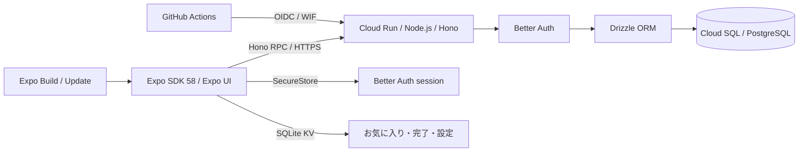

# アーキテクチャと技術選定

基準は2026年11月5日の[Expo技術選定検討](chatgpt-conversation://6aec01ec-6938-83e8-94df-24f41ae3ad55)と提供された開発仕様。依存関係の実際の解決版は `bun.lock` を正本とする。

## 採用構成

- Node.js 24、Bun 1.4.4、Expo 58、React Native 0.88、React 19.3。ネイティブ依存は `expo install` で互換版を選ぶ。
- Bun Workspaces + Turborepo。モバイルのネイティブモジュールを一つに解決するため、Bunの **hoisted linker** を明示する。
- Expo Routerは画面ルーティング専用。Honoを別サーバーとしてCloud Runで動かす。
- `@starter/api/contract` は `AppType` のtype-only公開入口。モバイルはHono RPCの型を再利用し、API実装をbundleへ混入させない。
- Zodは入力検証と共有モデル、DrizzleはPostgreSQLスキーマとmigrationを所有する。Drizzle ORM / Kitは `1.0.0-rc.5` に固定する。
- Better Auth + Expo pluginでメール認証。セッションはSecureStore。Google OAuthやGoogle APIキーは初期機能に必要ない。

Drizzle 1.0 RCは[公式の移行手順](https://orm.drizzle.team/docs/upgrade-v1)に従って採用する。DB接続は `drizzle({ client: pool })` を使い、認証のschemaはBetter Authのadapterへ渡す。Kitで廃止された `strict` 設定は削除した。既存migrationは `drizzle-kit up` でSQLとsnapshotを同じディレクトリへ移し、snapshotをversion 9へ変換した。SQLの内容・ハッシュと適用順序は保持し、テーブルの作り直しは行わない。

## UIと端末内データ

Daylightは小さな習慣を題材に、Native Tabs、Stack、ネイティブの設定フォーム、Picker、Slider、Switch、TextInput、Button、BottomSheetを試すアプリ。

共通 `@expo/ui` を使い、iOSではSwiftUI、AndroidではJetpack Composeのコントロールを表示する。タブのアイコンはSF SymbolsとMaterialを両方指定する。通常の画面レイアウトはReact Native、可変件数の検索結果はFlatListで実装する。

お気に入り、日付ごとの完了、外観、触覚、目標は `expo-sqlite/kv-store` に保存する。認証セッションとは分離する。サンプルはアカウントへデータを同期しない。Google Cloud未設定でもオフラインの操作を試せる。

## 品質ゲート

- Oxlint: Expo公式 `oxlint-config-universe/native` とNode設定、型付き解析。unsafe、未処理Promise、循環import、Hooks、テストの `.only` / skipを検査。
- ESLint: Perfectionist、正規表現、複雑度、Hono、Drizzle、Turborepo、Testing Libraryなど、Oxlint本体と重複させない補完ルールだけ。依存境界は `no-restricted-imports` とpackageの公開exportsで制限する。
- Oxfmt: 現在のCLIが正式対応する `.oxfmtrc.json` を使用。仕様案の `oxfmt.config.ts` に固執しない。
- Fallow: Expo Routerとworkspaceの公開入口を検出。ネイティブautolinkingやBabelが利用する依存、トンネル用CLIだけを明示的に除外する。
- Lefthook: stagedファイルの整形/lintとCommitlint。Conventional Commitsを要求し、Gitmoji・Issue番号は必須にしない。
- Bun Test: 共有ロジック、HTTP契約、実DB認証。Jest + jest-expo + RNTL: モバイルの画面操作。Maestro: 必要時だけ。

Jestのtransform設定にはBunのisolated配置も許可している。React Native 0.88のFlow/ESMを正しく変換するためで、テスト対象のアプリコードを除外しない。

## インフラと配信の所有者

OpenTofuはAPI有効化、Artifact Registry、Cloud SQL、DB、DBユーザー、サービスアカウント、IAM、WIF、Secret Managerの器、Cloud Runサービスとmigration Jobを管理する。

DBパスワードはOpenTofuのephemeral変数とGoogle providerのwrite-only引数を使用する。Secret Managerの**値**は手動投入し、コードやstateへ複製しない。bootstrap用GCS bucketはversioning、public access prevention、削除防止付き。

GitHub Actionsはmainの成功したCIに紐づくSHAだけをデプロイする。コンテナをdigestで指定し、migration Jobを完了させ、トラフィックなしのcandidate revisionで `/ready` を確認してから切り替える。その後に同じSHAのExpo Workflowを呼ぶ。本番配信には別途有効化フラグが必要。

WIFはGitHubの不変repository ID、リポジトリ名、main、`deploy.yml`に制限する。CIのサービスアカウントはインフラ管理者ではない。インフラ変更はADCでplanを確認して適用する。

PRのExpo Updateは、tablecast-pocの手動カタログ配備と同じコメント内チェックボックス、またはGitHub Actionsの手動実行で公開する。PR更新時はコメントだけを更新する。Expo Workflowsの無料実行時間を消費しないよう、bundle生成と公開はGitHub ActionsとExpo公式preview actionが担当する。配信先はPRごとのbranchで、共有staging APIを使う。PR単位のDB/API環境は初期構成に含めない。OTAの互換性境界はfingerprint。ネイティブ依存・設定が変わると新しいビルドが必要になる。

## 参照

- [Expo SDK 58](https://docs.expo.dev/versions/v58.0.0/)
- [Expo UI](https://docs.expo.dev/versions/v58.0.0/sdk/ui/)
- [Better Auth Expo統合](https://www.better-auth.com/docs/integrations/expo)
- [Expo Workflows](https://docs.expo.dev/eas/workflows/syntax/)
- [Expo MCP](https://docs.expo.dev/mcp/)
- [OpenTofu ephemerality](https://opentofu.org/docs/language/ephemerality/)
